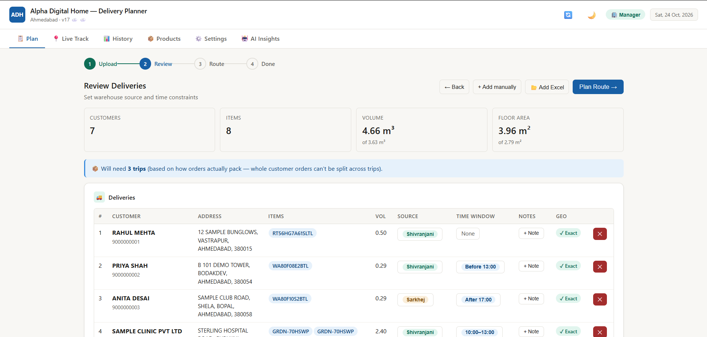
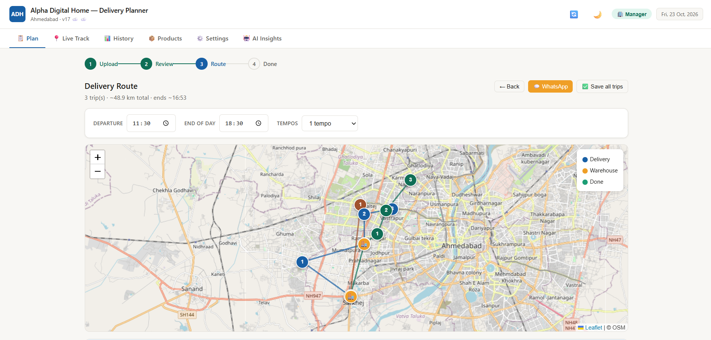

 # Alpha Digital Home — Route Planner

Built a route-planning and live delivery-tracking web app for Alpha Digital Home, a Samsung Electronics brand store in Ahmedabad, India. 

**Live app:** https://lucky-nasturtium-601dbe.netlify.app

## The problem

Every day, the store delivers large appliances (refrigerators, TVs, washing machines, ACs) from two warehouses to customers across Ahmedabad using small delivery tempos. Planning was done by hand: which items fit in which vehicle, what order to visit customers in, and how to meet customers' time windows. Once a driver left, the store had no visibility into progress until they returned.

## What the app does

**For the manager**
- Upload the day's delivery list straight from the store's billing Excel export (multiple files can be merged)
- Addresses are cleaned (expanding local abbreviations like NR, OPP, SOC) and geocoded with the Google Maps API
- Each order is matched to a product catalog of **125 Samsung model prefixes** with real packaging dimensions, so the app knows each item's volume, weight and floor space
- Deliveries are split into trips that fit the vehicle's capacity and respect customer time windows ("before 1 pm", "after 5 pm")
- Drag and drop to reorder stops within or across trips, with per-trip undo and save
- Live tracking of drivers, plus delivery history
- **ADH Delivery Intelligence** — an AI assistant tab that answers questions about delivery data, powered by the Anthropic API through a serverless function

**For the driver (Android, installable as an app)**
- Today's stops in order, with one-tap calling and navigation
- Mark deliveries done with optional photo proof
- Delivery notes, start/end time tracking, and offline detection

## Tech stack

| Part | Technology |
|---|---|
| Frontend | HTML, CSS, vanilla JavaScript (single-page app) |
| Installable app | Progressive Web App (manifest + service worker) |
| Maps | Leaflet, Google Maps Geocoding & Distance Matrix APIs |
| Cloud sync | Supabase (real-time sync between the manager's PC and drivers' phones) |
| AI assistant | Anthropic Claude API via a Netlify serverless function |
| Excel parsing | SheetJS |
| Hosting | Netlify |

## How it was built

I designed this app to solve a real problem at my store, and I built it by working with an AI coding assistant (Claude). I defined the features and requirements, made the design decisions, tested every version with real delivery data and our drivers, and directed the fixes. The app went through more than 17 versions.

Some of the harder problems I worked through:
- **Lost progress on save** — saving a trip wiped drivers' delivery progress; traced to old route state not being cleared
- **Timezone bug** — dates rolled over incorrectly between midnight and 5:30 am in India because of UTC conversion
- **Geocoding failures** — a Google API key restriction caused every request to be denied
- **Overlapping map markers** — stops that fell back to the same area-level coordinates hid each other on the map

## Running it yourself

1. Clone the repo.
2. Copy `config.example.js` to `config.js` and add your own Google Maps key and Supabase project details. (`config.js` is ignored by Git, so keys stay private.)
3. Open `index.html` with a local server, for example the VS Code **Live Server** extension.

To deploy on Netlify, connect this repository and set these environment variables: `GOOGLE_MAPS_KEY`, `SUPABASE_URL`, `SUPABASE_ANON_KEY`, `ANTHROPIC_API_KEY`. The build step creates `config.js` from them automatically.

## Note on data

All customer names, phone numbers and addresses in the sample data are fictional. No real customer data is stored in this repository.
